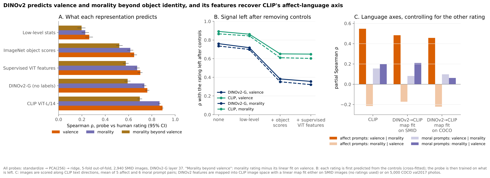

# Valence in visual models

This repo asks whether a vision model trained without labels or language represents how good or bad a scene is. It probes frozen DINOv2 for the human valence, arousal and morality ratings of the [Socio-Moral Image Database (SMID)](https://doi.org/10.1371/journal.pone.0190954), compares it with an ImageNet-supervised model and CLIP, and tests whether its good–bad direction lines up with CLIP's language.

## Results

### 1. Where in the network, and how it scales

A linear probe on DINOv2-G separates the most and least pleasant third of SMID images with AUROC 0.938 (95% CI 0.921–0.956) and predicts the continuous valence rating at Spearman ρ = 0.76. Morality reaches AUROC 0.936 and ρ = 0.74.

Object categories (Imagenette) are decodable at AUROC 0.95 within the first 15–20% of layers. Valence and morality rise roughly linearly with depth and peak at about 90% depth (panel A).

Across sizes, morality ρ goes 0.65 (S), 0.70 (B), 0.73 (L), 0.74 (G). Most of the gain is between S and L (panel C).

| Model | Params | Valence AUROC | Morality AUROC | Arousal AUROC | ρ valence | ρ morality | ρ arousal |
|---|---|---|---|---|---|---|---|
| DINOv2-S | 22M | 0.895 [0.865, 0.918] | 0.888 [0.861, 0.911] | 0.853 [0.825, 0.886] | 0.695 | 0.646 | 0.661 |
| DINOv2-B | 86M | 0.913 [0.890, 0.932] | 0.912 [0.895, 0.932] | 0.903 [0.880, 0.925] | 0.730 | 0.700 | 0.697 |
| DINOv2-L | 304M | 0.933 [0.914, 0.952] | 0.930 [0.912, 0.951] | 0.906 [0.883, 0.927] | 0.748 | 0.726 | 0.719 |
| DINOv2-G | 1.1B | 0.938 [0.921, 0.956] | 0.936 [0.921, 0.951] | 0.917 [0.894, 0.937] | 0.762 | 0.743 | 0.724 |

Best layer per model. AUROC: top vs. bottom third of the rating, 600 balanced images, 95% bootstrap CI. ρ: out-of-fold predictions vs. mean human rating, 2,940 images.

### 2. More than brightness and object identity

Hand-crafted image statistics (colour, brightness, contrast, edges; 57 features) predict valence at ρ = 0.26. The 1,000 class scores of a supervised ImageNet ViT-B/16 reach 0.65, and that model's internal features reach 0.70. DINOv2-G reaches 0.76 and CLIP ViT-L/14 0.89 (panel A).

To test whether DINOv2 adds information beyond those controls, each rating is first predicted from the controls (cross-fitted) and the probe is trained on the remainder. With low-level statistics, object scores and supervised-ViT features all removed, DINOv2 still predicts the remainder at ρ = 0.36 [0.33, 0.39] for valence and 0.32 [0.29, 0.36] for morality. CLIP keeps 0.65 and 0.60 (panel B). Removing low-level statistics alone barely changes DINOv2's score (0.72 for valence).

### 3. Morality is partly separable from valence

In SMID, mean valence and morality ratings correlate at ρ = 0.865. Subtracting a linear fit on valence leaves 24% of the variance in morality. SMID's per-image standard errors put about 19% of that remainder down to rating noise.

That remainder is predictable from images. DINOv2 predicts it at ρ = 0.59 [0.57, 0.62], CLIP at 0.70, object scores at 0.52 and low-level statistics at 0.20. Removing valence with a spline instead of a line gives 0.61 for DINOv2; also removing arousal gives 0.58 (`results/controls_and_language/morality_beyond_valence_robustness.csv`).

### 4. DINOv2's directions in CLIP's language space

DINOv2-G features were mapped into CLIP's image space with a linear map, and SMID images were then scored along CLIP text directions. Each direction is the difference between two prompts, averaged over 5 affect pairs (e.g. "something pleasant" vs. "something unpleasant") and 6 moral pairs (e.g. "someone being kind" vs. "someone being cruel").

Fitting the map on SMID images (no ratings used, held-out folds), the translated DINOv2 features find the right image among all 2,940 in 36% of cases. Chance is 0.03%. The affect direction then correlates with valence at ρ = 0.62, against 0.67 for real CLIP.

The two prompt families separate the two ratings (panel C). Controlling for morality, the affect direction tracks valence (partial ρ = 0.48; CLIP 0.55). Controlling for valence, the moral direction tracks morality (partial ρ = 0.21; CLIP 0.20), and the affect direction tracks it negatively (−0.17; CLIP −0.22).

The map fit on SMID uses SMID images, so it was refit on 5,000 unrelated COCO val2017 photos and applied unchanged to SMID. Retrieval stays at 36% top-1. The affect result holds (valence given morality 0.46). The moral result does not: morality given valence drops to 0.06. A map learned on everyday photos carries DINOv2's valence information into CLIP's space. Carrying the morality-specific part seems to need images with moral content in the fitting set.

The 12 words from a list of 140 that lie furthest along DINOv2's valence direction (SMID-fit map), at each end:

- pleasant end: love, peace, kindness, a family, happiness, joy, a mountain, a desert, fairness, the color green, friendship, a sunny day
- unpleasant end: war, murder, a battlefield, pain, a cigarette, violence, suffering, cruelty, a slum, horror, despair, terrorism

With the COCO-fit map, the pleasant end is fairness, a desert, the color yellow, love, peace, happiness, kindness, and the unpleasant end is murder, pollution, blood, smoke, a slum, vandalism, a funeral. The full lists for all directions and maps are in `results/controls_and_language/direction_words.csv`.

### What the rating scales look like

The lowest-valence and lowest-morality images are often about context (a segregation-era sign, texting while driving) more than dark or violent content.

## Limitations

- The translated DINOv2 features are a linear readout. They show that information matching CLIP's language axes is linearly present in DINOv2. They do not show that DINOv2 has a concept of morality.
- Direction-level alignment with the language axes was significant for the SMID-fit map (valence direction vs. affect axis: z = 4.7 against 100 label shuffles) but not for the COCO-fit map (z = 1.9).
- One dataset of ratings. No test yet on a second rated image set.
- DINOv2 S/B/L are distilled from G, so the size axis is not four independent training runs. One seed per setting.
- Imagenette saturates at AUROC 1.0, so it is a ceiling reference rather than a difficulty-matched comparison.

## Next steps

- Test the SMID-trained probes on a second rated image set, such as OASIS (900 images with valence and arousal ratings).
- Fit the DINOv2 → CLIP map on a larger, more varied image set and check whether the moral-language result returns.
- Edit images along the valence direction, following the linear-direction editing in [The Universal Normal Embedding](https://arxiv.org/abs/2603.21786).

## Method

- **Data.** SMID: 2,941 Creative Commons photos with mean ratings of valence, arousal, morality and relevance to five moral foundations (2,940 have all three main ratings). Imagenette: 3,000 images, 10 ImageNet classes. COCO val2017: 5,000 photos, used only to fit the translation map.
- **Features.** Frozen DINOv2 S/B/L/G (Hugging Face); per layer, the CLS token concatenated with the mean patch token. Controls: 57 image statistics; logits and final CLS feature of `google/vit-base-patch16-224`. CLIP: `openai/clip-vit-large-patch14` image and text embeddings, prompt template "a photo of {}".
- **Probes.** StandardScaler, then PCA (256, fit on training folds), then RidgeCV; 5-fold out-of-fold predictions. Translation maps use PCA 512 and multi-output ridge.

## Reproduce

Everything runs on a free Colab T4: [`notebooks/valence_probe_colab.ipynb`](notebooks/valence_probe_colab.ipynb), steps 1–12. It needs a Hugging Face token with access to the gated [SMID dataset](https://huggingface.co/datasets/AIML-TUDA/smid), stored as the Colab secret `HF_TOKEN`.

| Script | What it does |
|---|---|
| `src/extract_features.py` | per-layer DINOv2 features for SMID and a reference set |
| `src/run_probes.py` | layer-by-layer probes, figures for section 1 |
| `src/extract_controls_clip.py` | control features and CLIP embeddings |
| `src/analyze_controls_clip.py` | sections 2–4 |
| `src/robustness_morality.py` | spline residuals and rating-noise share |
| `src/coco_translation.py` | translation map fit on COCO |
| `src/make_figures.py`, `src/make_figure_controls_language.py` | figures |

Results tables are in `results/`. Features and SMID images are not in the repo.

## Data and licensing

SMID images are not redistributed here, except the 15 thumbnails in the gallery figure. They come from the Socio-Moral Image Database (Crone, Bode, Murawski & Laham, 2018, PLOS ONE); individual images are Creative Commons–licensed, with per-image credits in SMID's documentation. SMID contains disturbing images.

## Related work

- Jha et al., [Harnessing the Universal Geometry of Embeddings](https://arxiv.org/abs/2505.12540) (2025): unsupervised translation between embedding spaces.
- Tasker, Betser, Gofer, Levi & Gilboa, [The Universal Normal Embedding](https://arxiv.org/abs/2603.21786) (2026): a shared Gaussian latent space for vision encoders and diffusion noise.
- Zhu, Ramezani & Xu, *Visual moral inference and communication* (CogSci 2025): CLIP probes on SMID.
- Schramowski et al., [Q16](https://arxiv.org/abs/2202.06675): CLIP prompt-tuning on SMID for inappropriate-content detection.
