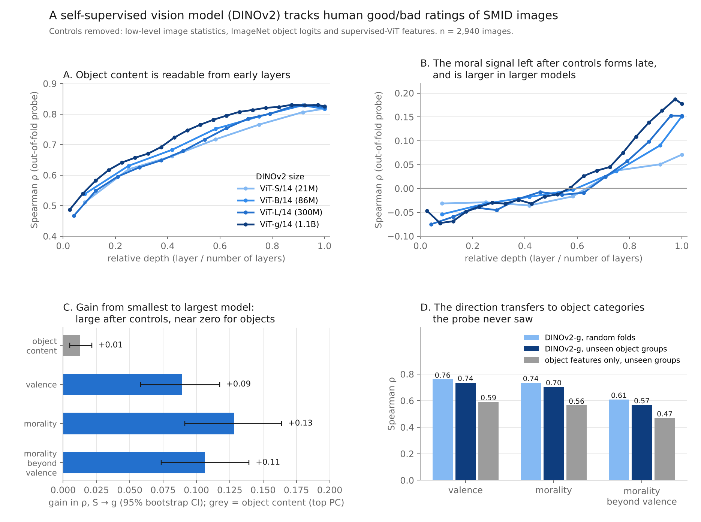
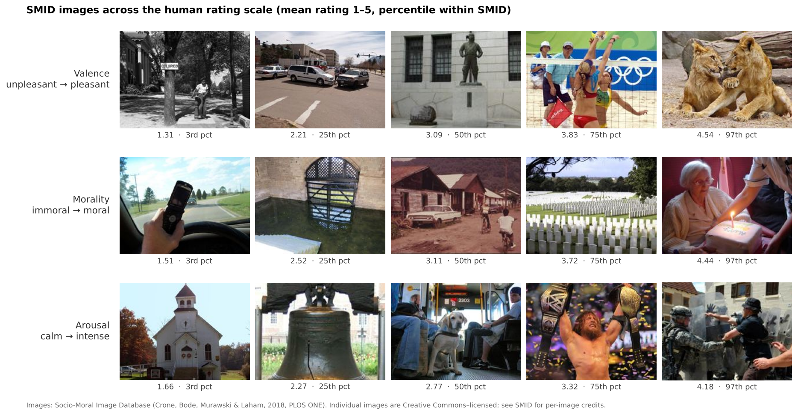

# Valence in visual models

Language models learn something like a concept of good and bad from human text. This repo asks whether a vision model trained only on images, with no labels and no language, learns it too.

We probe DINOv2, a self-supervised vision transformer, on the Socio-Moral Image Database (SMID): 2,940 photos rated by people for how pleasant they are (valence) and how morally good or bad the depicted scene is (morality). A linear probe on frozen DINOv2 features predicts both ratings well. The signal survives removing image statistics and object identity, it forms late in the network, and it grows with model size faster than object recognition does.



## Main findings

All numbers are Spearman ρ between held-out probe predictions and the mean human rating (5-fold, out-of-fold), with 95% bootstrap intervals where given. "Controls" means low-level image statistics, the 1,000 ImageNet logits of a supervised ViT, and that ViT's final features, removed with a cross-fitted linear probe.

1. **DINOv2 tracks both ratings.** The largest model (ViT-g, 1.1B parameters) reaches ρ = 0.76 for valence and 0.74 for morality. Separating the top third of images from the bottom third gives AUROC 0.94 for each.
2. **It is more than objects and image statistics.** After the controls, DINOv2 still predicts valence at 0.36 (0.32 to 0.39) and morality at 0.32 (0.29 to 0.35). Within clusters of images that share object content, it ranks valence at 0.67, against 0.55 for the control features themselves. Trained on some object groups and tested on unseen ones, it drops only from 0.76 to 0.74, while a probe on object features alone gets 0.59 (panel D).
3. **It forms late and grows with scale.** Object content is readable from the first layers. The moral signal left after removing valence and the controls is at or below zero for the first 60% of the network in every size, then rises in the last third (panel B). From the smallest to the largest model it grows by 0.11 (0.07 to 0.14), while object content grows by 0.01 (panel C).
4. **Part of morality is separate from pleasantness.** That leftover moral signal is small but real: ρ = 0.16 (0.13 to 0.20), and none of 200 label shuffles reached 0.05. Images rated more moral than their pleasantness predicts line up with CLIP words such as compassion, respect, care, grief and nurse. Images rated less moral than predicted line up with fun, phone, horse, car and cat. In other words, the model separates scenes of care during suffering from pleasant but morally neutral scenes.
5. **The direction is shared with a language-trained model.** A linear map from DINOv2 to CLIP, fit on 5,000 unrated COCO photos, lets CLIP's valence probe read valence from DINOv2 features at 0.66 (DINOv2's own probe: 0.76). With a map fit on the SMID images themselves, DINOv2's valence direction ranks CLIP words from love, peace and kindness to war, murder and pain. The COCO-fit map reproduces the valence result but not a clean match to moral wording, so treat the word lists as illustration.

## What this does not show

- **The morality-specific part does not survive the strictest control.** Removing everything the control features predict, linearly and with k-NN and gradient boosting stacked, leaves valence at 0.23 and morality at 0.20, but the part of morality beyond valence drops to 0.03 (not significant). The supervised ViT in the controls carries some of this signal itself, so this control removes more than objects. CLIP keeps 0.29 under the same control.
- **CLIP is stronger.** CLIP image features beat DINOv2 everywhere, for example 0.37 against 0.16 on the leftover moral signal. Language supervision helps.
- **The size comparison uses distilled models.** DINOv2's smaller models are distilled from the 1.1B model, so "larger" partly means "keeps more of the teacher". Separately trained sizes would make a cleaner test.
- **One dataset.** All ratings come from SMID. A second rated image set would test generality.
- **Not yet run:** a randomly initialised DINOv2 baseline and a larger DINOv2-to-CLIP map fit on Places365. Both need a GPU and are in step 16 of the notebook.
- **Probe, not judgment.** A probe shows that the information is linearly readable. It does not show that the model uses it or judges anything.

## What the ratings look like

Five SMID images per scale, ordered from low to high rating. SMID includes disturbing images.



## Method

- **Models.** DINOv2 ViT-S/14, B/14, L/14 and g/14 (`facebook/dinov2-*` on Hugging Face). Each image's feature at a layer is the CLS token concatenated with the mean patch token. References: CLIP ViT-L/14 and a supervised ViT-B/16 (`google/vit-base-patch16-224`).
- **Probe.** Standardise, PCA to 256 dimensions, ridge regression with the penalty chosen by internal cross-validation; 5-fold out-of-fold predictions.
- **Controls.** 57 low-level image statistics, such as brightness, contrast, colourfulness and edge density, ImageNet logits and supervised-ViT features. They are removed from the rating with cross-fitted predictions, and the DINOv2 probe is then trained on what is left.
- **Morality beyond valence.** The morality rating minus a cubic-spline fit on valence. Image-level valence and morality correlate at 0.87, so this part is about a quarter of the morality variance. About 30% of it is rater noise, estimated from SMID's per-image standard errors.
- **Cross-model map.** Ridge regression from DINOv2-g layer 37 to CLIP image embeddings, fit only on unrated COCO val2017 photos, then applied unchanged to SMID.

## Reproduce

Everything runs in Google Colab from [`notebooks/valence_probe_colab.ipynb`](notebooks/valence_probe_colab.ipynb). The notebook downloads the scripts from this repo and saves features and results to Google Drive, so a dropped runtime only loses the step that was running.

Before you start:
1. Accept the SMID terms at [huggingface.co/datasets/AIML-TUDA/smid](https://huggingface.co/datasets/AIML-TUDA/smid).
2. Add a Hugging Face read token as a Colab secret named `HF_TOKEN`.
3. Use a GPU runtime for the feature-extraction steps. The analysis steps run on CPU.

| Notebook step | What it does | Runtime |
|---|---|---|
| 1 to 5 | Download SMID, extract per-layer DINOv2 features for all four sizes, delete the images | GPU, about 25 min |
| 6 and 7 | Probes per layer and size, scaling figure | CPU, 1 to 2 h |
| 8 | Rating gallery | CPU |
| 9 | Control features (image statistics, supervised ViT) and CLIP embeddings | GPU, about 10 min |
| 10 and 11 | Probes after controls, CLIP language axes, robustness of morality beyond valence | CPU, about 25 min |
| 12 | DINOv2-to-CLIP map fit on COCO | GPU 6 min, then CPU 8 min |
| 15 | Significance and noise ceilings for the moral signal, round-3 analysis | CPU, about 35 min |
| 16 | Non-linear controls, held-out object groups, size and depth after controls, alignment with CLIP; GPU-only extras if a GPU is present | CPU, about 35 min |

To redraw the headline figure from the saved tables:

```bash
pip install pandas matplotlib
python src/make_figure_headline.py
```

### Repository layout

| Path | Contents |
|---|---|
| `src/extract_features.py`, `src/extract_controls_clip.py`, `src/extract_round3.py` | Feature extraction (GPU) |
| `src/run_probes.py` | Per-layer probes across model sizes |
| `src/analyze_controls_clip.py`, `src/coco_translation.py`, `src/analyze_round3.py` | Controls, CLIP map, language axes |
| `src/morality_diagnostics.py` | Permutation test, noise ceiling, content of the moral signal |
| `src/strengthen.py`, `src/scale_depth.py` | Non-linear controls, held-out object groups, size and depth after controls |
| `results/` | All result tables as CSV |
| `figures/` | Figures, with the scripts that draw them in `src/make_figure_*.py` |

## Data and licensing

SMID images are not redistributed here, except the 15 thumbnails in the gallery figure. They come from the Socio-Moral Image Database (Crone, Bode, Murawski & Laham, 2018, PLOS ONE). Individual images are Creative Commons licensed, with per-image credits in SMID's documentation. SMID contains disturbing images.

## Related work

- Huh, Cheung, Wang & Isola, [The Platonic Representation Hypothesis](https://arxiv.org/abs/2405.07987) (2024): representations of different models converge as they scale.
- Jha et al., [Harnessing the Universal Geometry of Embeddings](https://arxiv.org/abs/2505.12540) (2025): unsupervised translation between embedding spaces.
- Tasker, Betser, Gofer, Levi & Gilboa, [The Universal Normal Embedding](https://arxiv.org/abs/2603.21786) (2026): a shared Gaussian latent space for vision encoders.
- Zhu, Ramezani & Xu, *Visual moral inference and communication* (CogSci 2025): CLIP probes on SMID.
- Schramowski et al., [Q16](https://arxiv.org/abs/2202.06675) (2022): CLIP prompt-tuning on SMID for inappropriate-content detection.
- Oquab et al., [DINOv2](https://arxiv.org/abs/2304.07193) (2023).

## Acknowledgements

Thanks to Damien Crone and colleagues for SMID and its rating data, and to AIML-TUDA for hosting it on Hugging Face. DINOv2 is from Meta AI, CLIP from OpenAI, and the supervised ViT from Google; all were used through Hugging Face Transformers. COCO and Places365 photos were used, unrated, to fit the cross-model maps. Compute was Google Colab. Code, analysis and drafts were developed with help from Claude (Anthropic).
