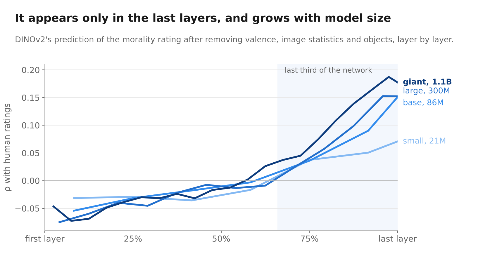

# Does a vision model know good from bad?

Language models pick up a sense of good and bad, and some moral judgment. That is not surprising: their training text is full of people explaining what is right and wrong. A vision model trained only on images, with no labels and no words, has no such teacher. Does it get there anyway?

We think it does. We probe the embedding space of **DINOv2**, a self-supervised vision transformer, on 2,940 photos from the Socio-Moral Image Database (SMID). People rated each photo for how morally good or bad it is, and for how pleasant or unpleasant it is (valence).


A linear probe on frozen DINOv2 features predicts the human morality rating at ρ = 0.74 on held-out images (valence: 0.76).

For every test in detail (data, method, what we measured and why, with references), see the **[technical report (PDF)](docs/technical_report.pdf)**.

## Is it really morality, or a convenient shortcut?

A probe can score well by latching onto something that merely travels with morality. There are three obvious shortcuts, and we test each one the same way: measure how much of the rating the shortcut explains, remove that part, and check whether DINOv2 can still predict what is left. All numbers are on images the probe never trained on.

**1. Image statistics.** Photos of bad things may simply be darker, greyer or grainier. We computed 57 simple statistics per image (brightness, contrast, colour, edges, colour histograms). Removing everything they explain barely moves the result: 0.74 becomes 0.70.

**2. Objects.** Maybe DINOv2 just recognises guns, tanks and puppies. We removed everything that a standard ImageNet classifier knows about the image: its 1,000 object scores and its internal features. This is the biggest drop, but DINOv2 still predicts morality at 0.32, far above anything shuffled ratings produce (0.05 at most in 200 tries).


**3. Pleasantness.** Morality and pleasantness go together in SMID (they correlate at 0.87), so the probe could be reading "pleasant vs unpleasant" and getting morality for free. We removed from each morality rating the part that pleasantness predicts. What remains is the morality people see beyond how nice the image looks. DINOv2 predicts it at 0.61, and still at 0.16 after also removing objects and image statistics (right panel above). The images make the distinction concrete: rescue workers, firefighters and nurses are unpleasant to look at but morally good; burgers, cash and sports cars are pleasant but not especially good.


## Diving deeper: what the morality direction in DINOv2 means

The probe gives us a direction in DINOv2's latent space: move an image's embedding one way and it looks "better", the other way "worse". But that direction is just a list of numbers. To read it, we need a dictionary from DINOv2's space to words.

CLIP provides one: it was trained to put an image and its caption close together, so in CLIP's space you can compare any image with any word. DINOv2 and CLIP were trained very differently, yet recent work shows that the embedding spaces of different models are largely translatable into each other ([Jha et al., 2025](https://arxiv.org/abs/2505.12540)). We use the simplest version of this idea:

1. **Learn a translation.** We pass the same 5,000 everyday photos (COCO, no ratings) through both models and fit a linear map from DINOv2's embedding to CLIP's embedding of the same photo. The map never sees a SMID image or a moral rating.
2. **Translate the SMID images.** Each SMID photo's DINOv2 embedding is mapped into CLIP's space, so we can compare it with words. The translation is good enough to work: a valence probe trained in CLIP's space reads valence from the translated DINOv2 embeddings at 0.72.
3. **Ask which words move with DINOv2's score.** For each word ("a photo of kindness", "a photo of a car", ...) we measure how strongly its similarity to the translated images rises and falls with DINOv2's own morality score across all 2,940 images. The vocabulary is fixed in advance: 150 words split into virtues, vices, positive and negative emotions, and everyday things.

This tells us what DINOv2's direction is about, in human terms, without trusting any single rating.


The morality direction reads as fairness, volunteering and helping others against decay, neglect and vandalism. The direction for morality beyond pleasantness is sharper: volunteering, helping others, heroism, cooperation and respect, against beauty, pets, pizza and flowers. Virtue words beat merely pleasant words 84% of the time. One surprise in that list is "slavery" in fifth place, likely from SMID's historical and memorial photos.

## How does a model that never saw a word learn this?

**It forms late, and grows with scale.** Object identity is readable from DINOv2's first layers. The moral signal, after removing pleasantness and objects, is absent for the first half of the network, appears in the last third, and is stronger in larger models.



**Different models converge on the same direction.** CLIP learned good vs bad from captions; DINOv2 never saw one. Yet CLIP's morality direction, carried into DINOv2 through a translation learned without any ratings, predicts morality from DINOv2's features at 0.73, nearly as well as DINOv2's own probe (0.74). The agreement grows with depth and with model size, and good vs bad takes up more of DINOv2's ten main axes in larger models.


Our reading: good vs bad is part of the structure of the world people photograph (who helps, who harms, what happens to whom), so a model that learns that world well enough ends up representing it. This fits the Platonic Representation Hypothesis ([Huh et al., 2024](https://arxiv.org/abs/2405.07987)) and the Natural Abstraction Hypothesis ([Wentworth, 2021](https://www.lesswrong.com/posts/cy3BhHrGinZCp3LXE/testing-the-natural-abstraction-hypothesis-project-intro)). It is one dataset and a linear probe, so treat it as evidence, not proof.

## Caveats

- One rated dataset (SMID). A second one would test how general this is.
- DINOv2's smaller models are distilled from the largest, so the size trend is partly about how much of the teacher a student keeps.
- CLIP, trained with language, is stronger everywhere. Under the strictest control (non-linear removal of everything a supervised classifier sees), the morality-beyond-pleasantness signal in DINOv2 is no longer significant.
- A probe shows the information is there and linearly readable, not that the model uses it.

## Reproduce

Everything runs in Google Colab from [`notebooks/valence_probe_colab.ipynb`](notebooks/valence_probe_colab.ipynb). Accept the SMID terms on [Hugging Face](https://huggingface.co/datasets/AIML-TUDA/smid) and add a read token as a Colab secret named `HF_TOKEN`. Feature extraction (steps 1 to 5, 9 and 12) needs a GPU. The analysis steps run on CPU and save everything to Google Drive, so a dropped runtime only loses the step that was running.

To redraw the figures from the saved tables:

```bash
pip install pandas matplotlib pillow
python src/make_story_figures.py
```

Result tables are in [`results/`](results) and the scripts in [`src/`](src).

## Acknowledgements

This work builds on:

- **SMID**: Crone, Bode, Murawski & Laham (2018). [The Socio-Moral Image Database (SMID): A novel stimulus set for the study of social, moral and affective processes](https://doi.org/10.1371/journal.pone.0190954). *PLOS ONE* 13(1). Images are Creative Commons licensed; only the thumbnails in the figures are reproduced here.
- **DINOv2**: Oquab et al. (2023). [DINOv2: Learning Robust Visual Features without Supervision](https://arxiv.org/abs/2304.07193).
- **CLIP**: Radford et al. (2021). [Learning Transferable Visual Models From Natural Language Supervision](https://arxiv.org/abs/2103.00020).
- **ViT**: Dosovitskiy et al. (2021). [An Image is Worth 16x16 Words](https://arxiv.org/abs/2010.11929).
- **COCO**: Lin et al. (2014). [Microsoft COCO: Common Objects in Context](https://arxiv.org/abs/1405.0312).
- **Translating between embedding spaces**: Jha, Zhang, Shmatikov & Morris (2025). [Harnessing the Universal Geometry of Embeddings](https://arxiv.org/abs/2505.12540).
- **Convergent representations**: Huh, Cheung, Wang & Isola (2024). [The Platonic Representation Hypothesis](https://arxiv.org/abs/2405.07987).
- **Natural abstractions**: Wentworth (2021). [Testing The Natural Abstraction Hypothesis: Project Intro](https://www.lesswrong.com/posts/cy3BhHrGinZCp3LXE/testing-the-natural-abstraction-hypothesis-project-intro).
- **Moral directions in language models**: Schramowski et al. (2022). [Large pre-trained language models contain human-like biases of what is right and wrong to do](https://doi.org/10.1038/s42256-022-00458-8). *Nature Machine Intelligence* 4.
- **Moral inference from images with CLIP on SMID**: Zhu, Ramezani & Xu (2025). [Visual moral inference and communication](https://arxiv.org/abs/2504.11473). *CogSci 2025*.
- **Linear probes**: Alain & Bengio (2016). [Understanding intermediate layers using linear classifier probes](https://arxiv.org/abs/1610.01644).
