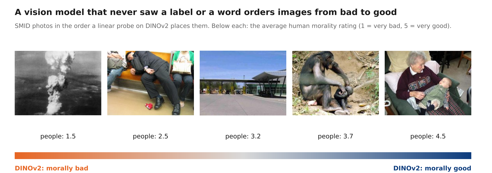
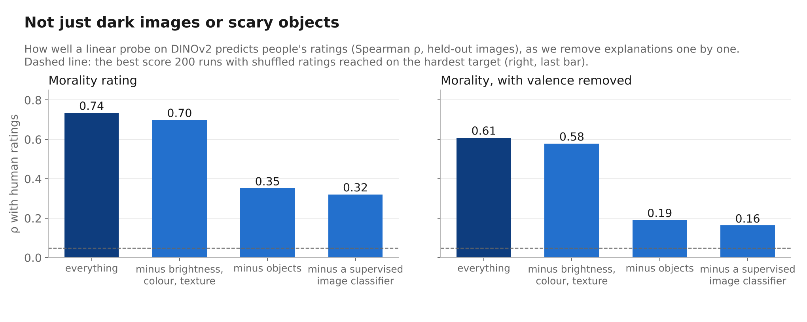
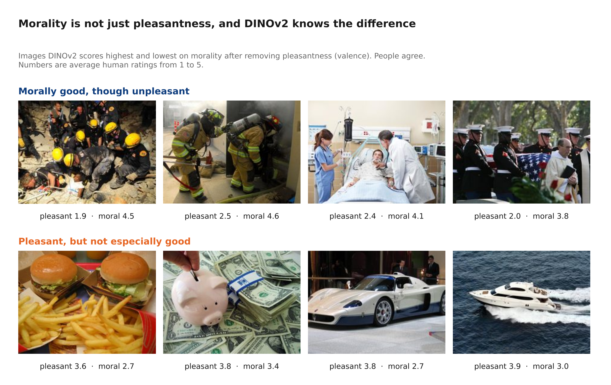
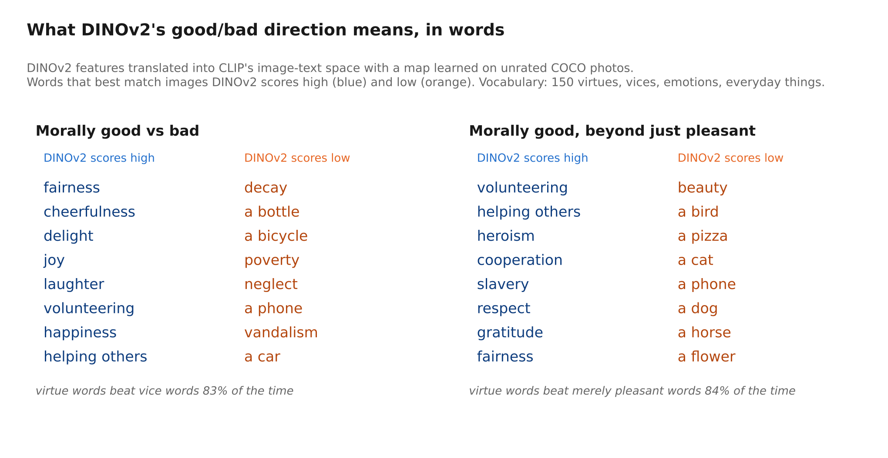
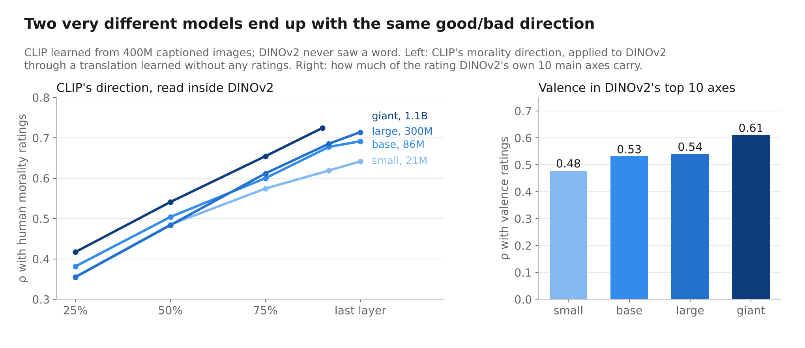

# Does a vision model know good from bad?

Language models pick up a sense of good and bad, and some moral judgment. That is not surprising: their training text is full of people explaining what is right and wrong. A vision model trained only on images, with no labels and no words, has no such teacher. Does it get there anyway?

We think it does. We probe the embedding space of **DINOv2**, a self-supervised vision transformer, on 2,940 photos from the Socio-Moral Image Database (SMID). People rated each photo for how morally good or bad it is, and for how pleasant or unpleasant it is (valence).



A linear probe on frozen DINOv2 features predicts the human morality rating at ρ = 0.74 on held-out images (valence: 0.76).

## "It's just dark images and scary objects"

A fair suspicion. So we remove those explanations one at a time: first brightness, colour and texture, then object identity (the 1,000 ImageNet classes), then everything a supervised image classifier sees. The signal shrinks but stays well above chance. The same holds for the part of morality that has nothing to do with pleasantness (right).



## "It's not morality, it's just pleasant vs unpleasant"

Morality and pleasantness are strongly correlated in SMID (0.87), so this is the harder objection. Removing pleasantness from the morality rating leaves a smaller signal, and DINOv2 still predicts it: ρ = 0.61, and 0.16 after also removing objects, where no run on shuffled labels out of 200 got above 0.05. What it picks up is intuitive. Rescue workers, firefighters and nurses are unpleasant to look at but morally good; burgers, cash and sports cars are pleasant but not especially good.



## "Are these labels really about morality?"

Ratings are noisy, so we asked DINOv2's direction what it means, in words. We translate DINOv2's features into CLIP's shared image-text space with a linear map learned on unrated COCO photos; the map never sees SMID or any rating. Then we check which words best match the images DINOv2 scores high and low, from a fixed vocabulary of 150 virtues, vices, emotions and everyday things.



The morality direction reads as fairness, volunteering and helping others against decay, neglect and vandalism. The "good beyond pleasant" direction reads as volunteering, heroism, cooperation and respect against beauty, pets, pizza and flowers: virtue words beat merely pleasant words 84% of the time. One surprise in that list is "slavery" in fifth place, likely from SMID's historical and memorial photos.

## How does a model that never saw a word learn this?

**It forms late, and grows with scale.** Object identity is readable from DINOv2's first layers. The moral signal, after removing pleasantness and objects, is absent for the first half of the network, appears in the last third, and is stronger in larger models.


**Different models converge on the same direction.** CLIP learned good vs bad from captions; DINOv2 never saw one. Yet CLIP's morality direction, carried into DINOv2 through a translation learned without any ratings, predicts morality from DINOv2's features at 0.73, nearly as well as DINOv2's own probe (0.74). The agreement grows with depth and with model size, and good vs bad takes up more of DINOv2's ten main axes in larger models.



Our reading: good vs bad is part of the structure of the world people photograph (who helps, who harms, what happens to whom), so a model that learns that world well enough ends up representing it. This fits the [Platonic Representation Hypothesis](https://arxiv.org/abs/2405.07987) and the [Natural Abstraction Hypothesis](https://www.lesswrong.com/posts/Fut8dtFsBYRz8atFF/the-natural-abstraction-hypothesis-implications-and-evidence). It is one dataset and a linear probe, so treat it as evidence, not proof.

## Caveats

- One rated dataset (SMID). A second one would test how general this is.
- DINOv2's smaller models are distilled from the largest, so the size trend is partly about how much of the teacher a student keeps.
- CLIP, trained with language, is stronger everywhere. Under the strictest control (non-linear removal of everything a supervised classifier sees), the morality-beyond-pleasantness signal in DINOv2 is no longer significant.
- A probe shows the information is there and linearly readable, not that the model uses it.

## Reproduce

Everything runs in Google Colab from [`notebooks/valence_probe_colab.ipynb`](notebooks/valence_probe_colab.ipynb). Accept the SMID terms on [Hugging Face](https://huggingface.co/datasets/AIML-TUDA/smid) and add a read token as a Colab secret named `HF_TOKEN`. Feature extraction (steps 1 to 5, 9 and 12) needs a GPU. The analysis steps run on CPU and save everything to Google Drive, so a dropped runtime only loses the step that was running.

To redraw the figures from the saved tables:

```bash
pip install pandas matplotlib pillow
python src/make_story_figures.py
```

Result tables are in [`results/`](results) and the scripts in [`src/`](src).

## Credits

SMID is by Crone, Bode, Murawski and Laham (2018, PLOS ONE), hosted on Hugging Face by AIML-TUDA. Its images are Creative Commons licensed and are not redistributed here beyond the thumbnails in the figures. DINOv2 is from Meta AI, CLIP from OpenAI and the supervised ViT from Google, all used through Hugging Face Transformers. COCO photos were used, unrated, to fit the DINOv2-to-CLIP map. Compute was Google Colab. Built with help from Claude (Anthropic).
