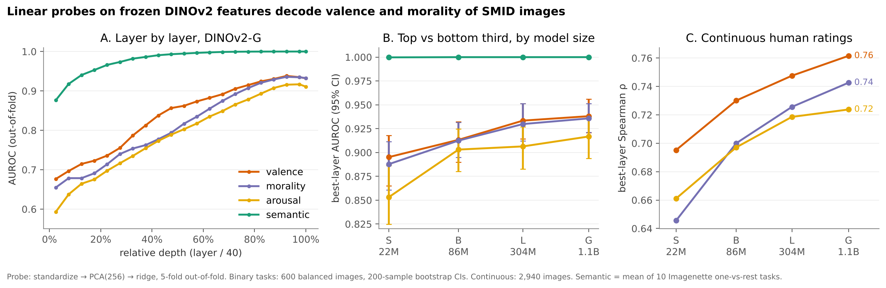

# Valence in visual models

Do vision models that never saw language or labels still represent whether a scene is *good or bad*?
This repo probes frozen **DINOv2** (self-supervised, image-only) for the human **valence**, **arousal** and **morality** ratings of the [Socio-Moral Image Database (SMID)](https://doi.org/10.1371/journal.pone.0190954), layer by layer and across four model sizes.



## Findings so far

1. **The information is there.** A linear probe on DINOv2-G separates the most vs. least pleasant third of SMID images with AUROC 0.94, and predicts the continuous human ratings at Spearman ρ = 0.76 (valence) and 0.74 (morality).
2. **It appears late in the network.** Object categories (Imagenette) are decodable at AUROC ≈ 0.95 within the first 15–20% of layers. Valence and morality climb roughly linearly with depth and peak around 90% depth (panel A).
3. **It grows with model size, with diminishing returns.** Morality ρ goes 0.65 → 0.70 → 0.73 → 0.74 from S to G; most of the gain comes before L (panel C).
4. **Low-level cues carry some of it.** The first layer already gives AUROC ≈ 0.65–0.68 for valence.
5. **Morality and valence are not yet separable.** In SMID the two human ratings correlate at ρ = 0.86, and the probes track each other at every layer and size.

| Model | Params | Valence AUROC | Morality AUROC | Arousal AUROC | ρ valence | ρ morality | ρ arousal |
|---|---|---|---|---|---|---|---|
| DINOv2-S | 22M | 0.895 [0.865, 0.918] | 0.888 [0.861, 0.911] | 0.853 [0.825, 0.886] | 0.695 | 0.646 | 0.661 |
| DINOv2-B | 86M | 0.913 [0.890, 0.932] | 0.912 [0.895, 0.932] | 0.903 [0.880, 0.925] | 0.730 | 0.700 | 0.697 |
| DINOv2-L | 304M | 0.933 [0.914, 0.952] | 0.930 [0.912, 0.951] | 0.906 [0.883, 0.927] | 0.748 | 0.726 | 0.719 |
| DINOv2-G | 1.1B | 0.938 [0.921, 0.956] | 0.936 [0.921, 0.951] | 0.917 [0.894, 0.937] | 0.762 | 0.743 | 0.724 |

Best layer per model. AUROC: top vs. bottom third of the rating, 600 balanced images, 95% bootstrap CI. ρ: Spearman correlation of out-of-fold predictions with the mean human rating, 2,940 images. Imagenette (semantic) is 1.000 for every size.

### What the rating scales look like


The low ends of valence and morality are often about *context* (a segregation-era sign, texting while driving), not dark or gory pixels.

## Method

- **Data.** SMID: 2,941 Creative Commons photos with mean ratings of valence, arousal, morality and relevance to five moral foundations. Semantic reference: 3,000 Imagenette images (10 ImageNet classes, 300 each).
- **Features.** Frozen DINOv2 S/B/L/G from Hugging Face; per layer, the CLS token concatenated with the mean patch token (DINOv2's own linear-eval readout).
- **Probe.** StandardScaler → PCA(256, fit on training folds) → RidgeCV; 5-fold out-of-fold predictions. Every second layer plus the last.
- **Tasks.** Binary: top vs. bottom third (SMID) or one class vs. rest (Imagenette), all balanced to 600 images. Continuous: SMID mean ratings.

## Caveats

- **Valence vs. morality** are confounded in SMID (ρ = 0.86 between ratings).
- **No baseline models yet** (random-init ViT, ImageNet-supervised ViT), so we can't yet say how much of this is beyond generic object recognition.
- **Imagenette saturates** at AUROC 1.0, so it is a ceiling reference, not a fair difficulty-matched comparison.
- **Scale is confounded with distillation**: DINOv2 S/B/L are distilled from G. One seed per setting.

## Next steps

1. **Beyond objects.** Regress out an ImageNet classifier's 1,000 object probabilities and test whether DINOv2 still predicts the residual valence.
2. **Name the axis with language.** Map DINOv2 features into CLIP space (linear map fit on SMID images) and compare the valence direction with CLIP text directions such as "a pleasant scene" vs. "an unpleasant scene", or "a kind act" vs. "a cruel act". This is the cleanest shot at separating morality from valence.
3. **Edit along the direction** (if feasible), following the linear-direction editing in [The Universal Normal Embedding](https://arxiv.org/abs/2603.21786).

Related: [Harnessing the Universal Geometry of Embeddings](https://arxiv.org/abs/2505.12540) (vec2vec); Zhu, Ramezani & Xu, *Visual moral inference and communication* (CogSci 2025), which probes CLIP on SMID; Schramowski et al., [Q16](https://arxiv.org/abs/2202.06675).

## Reproduce

Everything runs on a free Colab T4: [`notebooks/valence_probe_colab.ipynb`](notebooks/valence_probe_colab.ipynb). It needs a Hugging Face token with access to the gated [SMID dataset](https://huggingface.co/datasets/AIML-TUDA/smid), stored as the Colab secret `HF_TOKEN`.

```bash
python src/extract_features.py --smid-dir data/smid --semantic-dir data/imagenette2-320/train --models S B L G --out features
python src/run_probes.py --features features --out results_S --models S --layer-stride 2   # repeat per size
python src/make_figures.py                                                             # figures/fig_main_results.png
```

`results/` holds the full per-layer table (`probe_results.csv`), the SMID rating correlations, and the file names and ratings of the gallery images. Features (2.3 GB) and SMID images are not in the repo.

## Data and licensing

SMID images are not redistributed here, except the 15 thumbnails in the gallery figure. Those come from the Socio-Moral Image Database (Crone, Bode, Murawski & Laham, 2018, PLOS ONE); individual images are Creative Commons–licensed, with per-image credits in SMID's own documentation. SMID contains disturbing images.
